# 🧠 SPIKE — wire neurons, run a body

**[Releases](https://github.com/ixaxaar/spikes/releases)** · **[What is real](docs/WHAT-IS-REAL.md)** · **[Changelog](CHANGELOG.md)** · **[Issues](https://github.com/ixaxaar/spikes/issues)**

**Build small spiking neural circuits and watch them run a body.** Wire sensory cells to interneurons to motor pools, and a leg kicks, a lamprey swims, a heart speeds up when you stand, a pupil narrows in the light, a worm backs away from a touch. Every neuron is a real [NEST](https://www.nest-simulator.org/) model, simulated live inside the game, in NEST's own names and units (mV, ms, pA, nS, Hz).

The front-end is a **Godot 4.7** game drawn as a 19th-century histology plate: India ink and Golgi stain on paper, sienna for excitation, Prussian blue for inhibition. Underneath it, the NEST kernel is linked statically into a C++ engine (no Python at runtime) that runs the circuit and a simplified body in a closed loop, 1 ms at a time.

> **Alpha (0.5 in progress).** Playable on desktop Linux. Rough in places: see the [changelog](CHANGELOG.md) for known gaps. Tell us what broke or confused you in [issues](https://github.com/ixaxaar/spikes/issues).

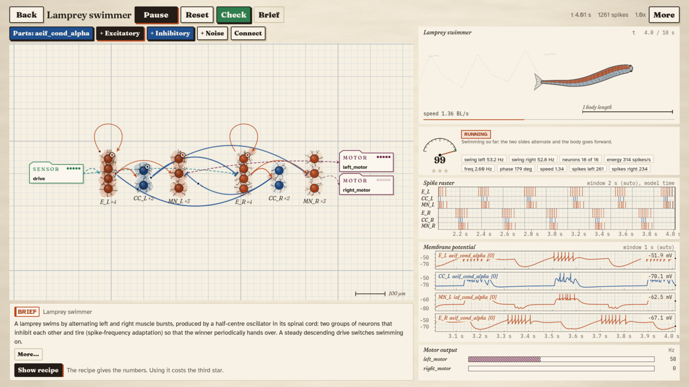

## What you actually do

| | |
|---|---|
| **Build** | An empty bench with the level's sensor and motor cards. Add neurons from a parts bin of NEST and NESTML cells (integrate-and-fire, adaptive exponential, Izhikevich, Hodgkin-Huxley, an SA-node pacemaker, a brainstem burster, a gut pacemaker), drag connections, set weights. |
| **Run** | A live spike raster, voltage traces, gauges and the body itself: a limb, a heart with blood pressure, lungs, an eye, a gut, a swimming lamprey, a crawling worm. |
| **Check** | Instant headless scoring over several seeds. The verdict says what your circuit did and which part of the mechanism is missing, never the answer. |
| **Learn** | One new idea per level, a three-tier hint ladder, a recipe you can buy with a star, a lab notebook of cited findings and a glossary of concepts. |
| **Diagnose** | A patient's circuit with a hidden lesion and a list of symptoms. Probe it with the scopes and the lesion lab, then name the broken connection. |
| **Dissect** | A lesion lab with multi-seed re-runs, motif census, burst and HRV analysis, phase-response curves and an energy bill. |

**The campaign.** Five body chapters (Invertebrates, Spinal cord, Heart, Breathing, Autonomic) climb from a single cell crossing threshold to a whole day of autonomic control: 19 micro-puzzles, 14 tasks, 2 bosses and 6 diagnosis cases. The **Bestiary** adds a chapter per model organism, built around the circuit neuroscience knows best: the *C. elegans* touch switch (wired from the real connectome), the leech heartbeat, *Aplysia* habituation and sensitisation, and in progress the fly compass, the fly mushroom body and the crab pyloric rhythm. The **Theory** wing covers what a computational-neuroscience course teaches, in four chapters of three levels: the phase plane (class I and II, phasic firing, a one-neuron switch), rate models and mean field (a Wilson-Cowan oscillator, winner take all, a spiking network against its siegert prediction), Hopfield attractor memory (recall from a part, two patterns without blends, a pattern written by STDP) and tuning and decoding (a tuned cell, sharpening, the population vector), plus a spike-triggered-average tab in the Analysis screen ([design](docs/DESIGN-THEORY.md)).

**Three modes.** **Guided** (recipe in the brief, free hints), **Standard** (the recipe costs the third star) and **Researcher** (no recipe, no hints, a pass needs five seeds). Modes change tolerance and noise, never the circuit.

**Honest by design.** Every level checks the mechanism it teaches through the circuit's structure, so a cheap trick that happens to hit the numbers fails. Verdicts and early hints carry no numbers. Each level has a table of cheap circuits that must fail, in the test suite. Citations are checked against PubMed with DOIs. A **What is real** page, in the game and in [the docs](docs/WHAT-IS-REAL.md), says what is NEST, what was tuned and what is illustrative.

## Screenshots

| The campaign | A first level |
|---|---|
| 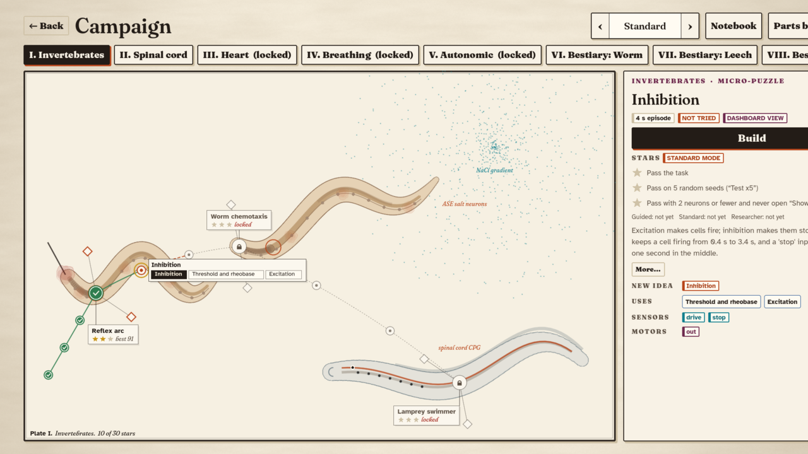 | 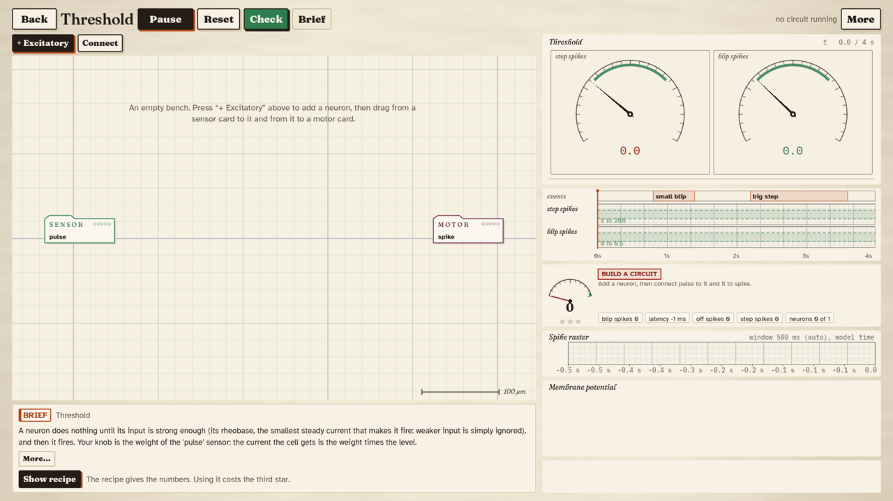 |
| **The hint ladder** | **The parts bin** |
| 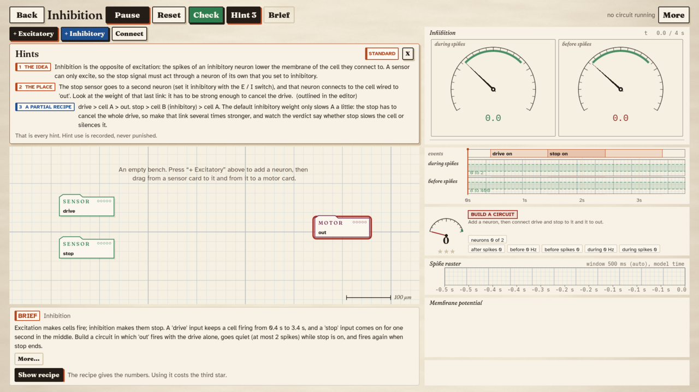 | 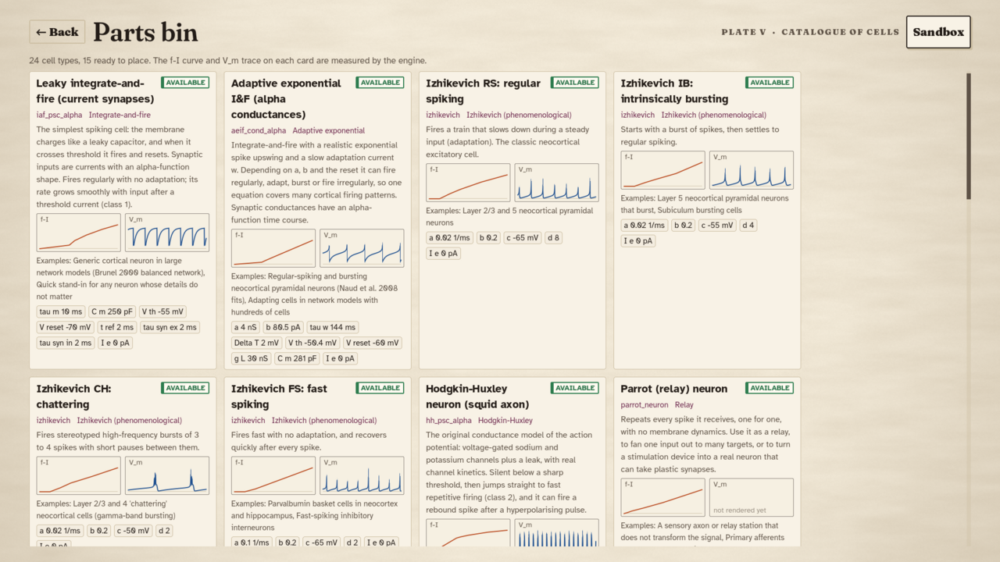 |

## The bodies

| Heart and circulation | Stretch reflex |
|---|---|
| 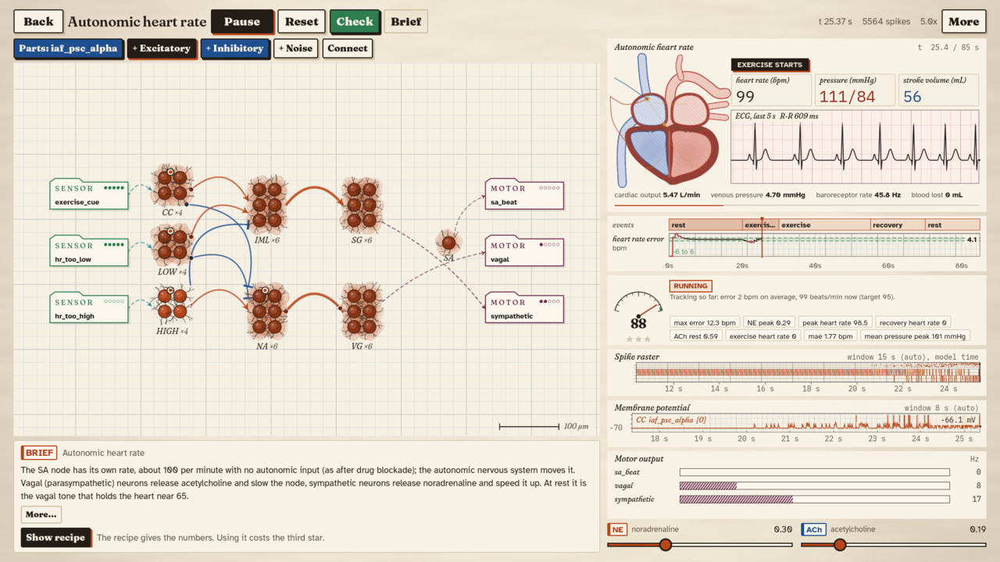 | 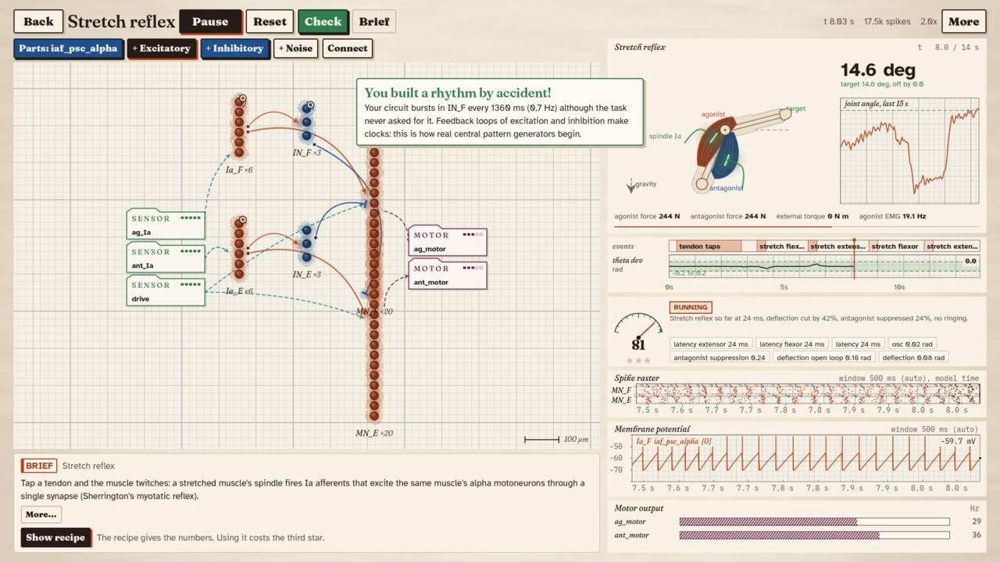 |
| **Breathing** | **Pupil** |
| 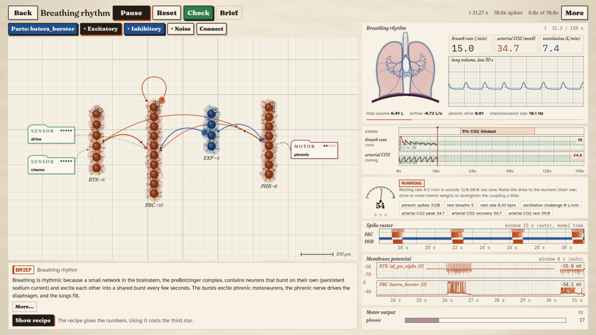 | 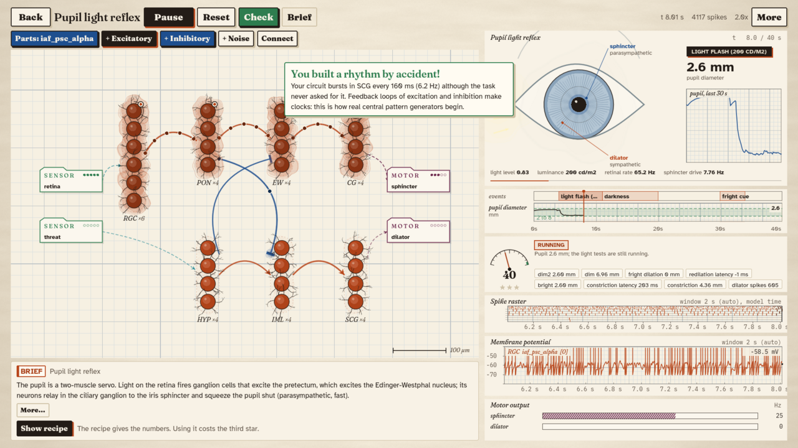 |
| **Gut** | **The autonomic exam (boss)** |
| 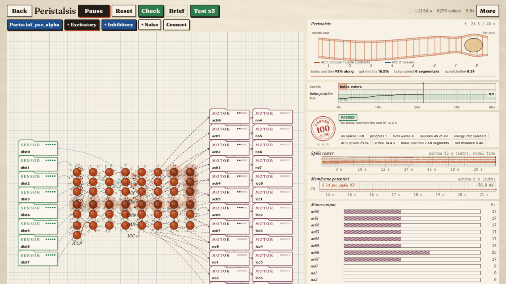 | 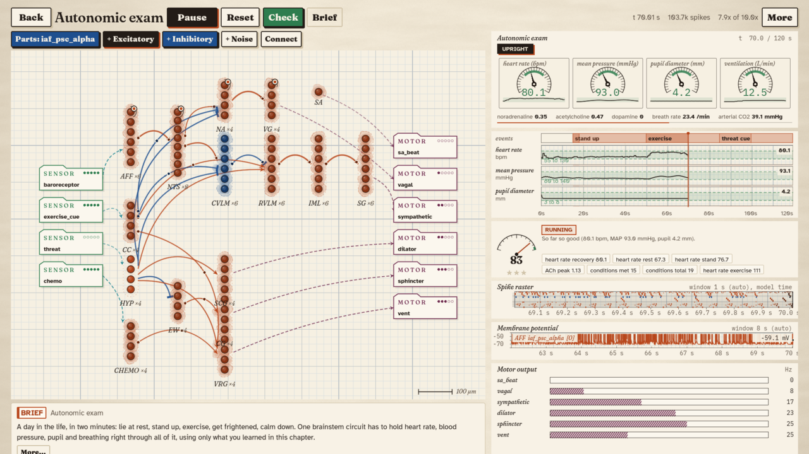 |

## The Bestiary

| Leech heartbeat | *Aplysia*: the reflex that does not sensitise |
|---|---|
| 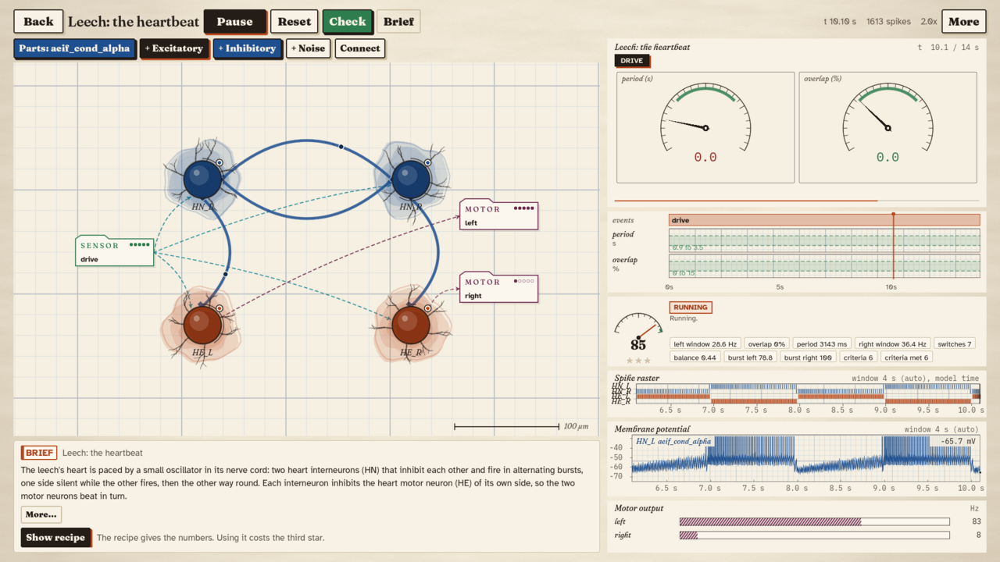 | 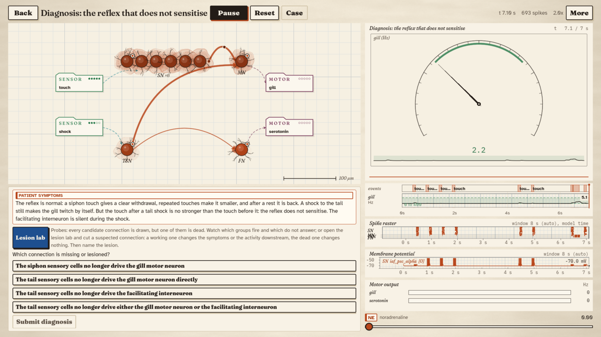 |
| **Diagnosis** | **Lesion lab** |
| 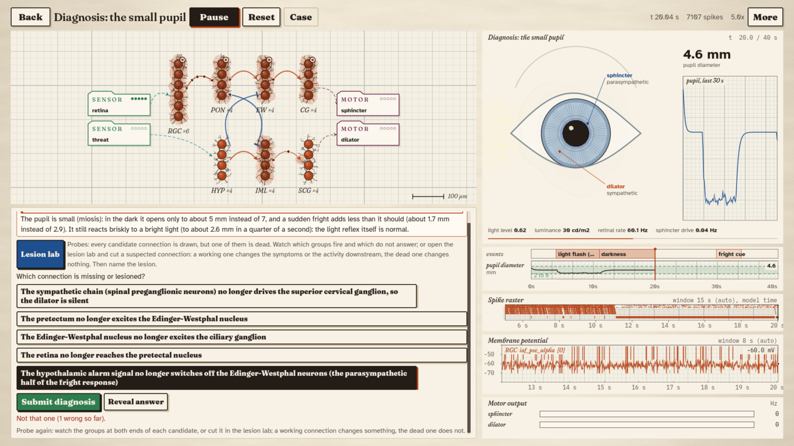 | 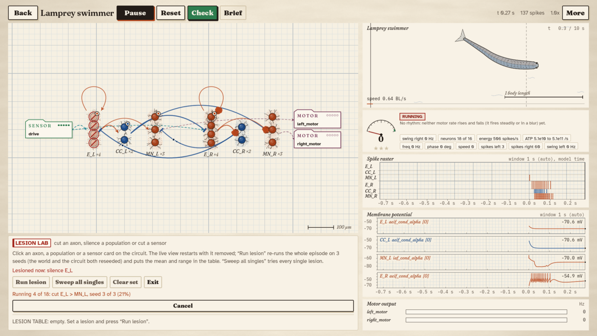 |

## A circuit is data

A circuit is one JSON file ([docs/CIRCUIT-FORMAT.md](docs/CIRCUIT-FORMAT.md)). The game, the C++ engine and the Python package read the same file, so a circuit built in the game runs unchanged in PyNEST, with identical spikes (a parity test checks it).

```python
import spike                                  # python/
net = spike.build("my_circuit.json")          # the file you saved in the game
spikes = spike.run(net, 1000.0)
```

`spike-run --task reflex --circuit my_circuit.json --seeds 1,2,3` scores it headless, exactly as CHECK does. Details: [docs/BUILD.md](docs/BUILD.md#command-line).

## Download

Linux x86_64 only for now (glibc 2.39 / Ubuntu 24.04 or newer). Grab `spike-linux-x86_64.zip` from [Releases](https://github.com/ixaxaar/spikes/releases), extract, run `Spike.x86_64`. Windows is planned; the missing piece is cross-building NEST.

## Run from source

Needs a C++20 compiler, CMake 3.24+, static GSL, Python 3 and Godot 4.7.

```sh
scripts/build-all.sh --tests   # NEST (pinned), NESTML cells, engine, extension, spike-run, tests
godot --path godot
```

Or in Docker: `docker build -t spike-build . && docker run --rm -v "$PWD":/src spike-build scripts/build-all.sh --tests`. Everything else (packaging, tests, the command line, custom cells): [docs/BUILD.md](docs/BUILD.md).

## Architecture

```
NEST (pinned commit, static)    the simulator; NESTML cells compiled in
engine/   C++20 -> libspike     circuit JSON -> NEST, closed-loop step, structure queries,
                                tasks (one file per level), bodies, analysis, spike-run
gdext/    GDExtension           SpikeSim, SpikeTask
godot/    the game              code-built UI, levels in godot/circuits, parts in godot/catalog
python/   spike package         the same circuit JSON in PyNEST, plus analysis
```

Design and plans: [docs/PLAN.md](docs/PLAN.md), [docs/DESIGN-0.5.md](docs/DESIGN-0.5.md), the visual identity in [docs/IDENTITY.md](docs/IDENTITY.md).
