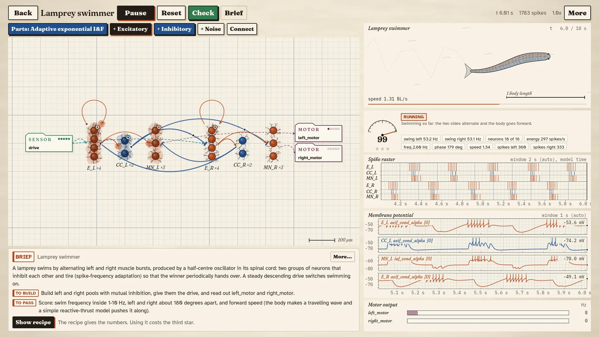

Spike is a game and a research tool about small spiking neural circuits. You wire sensory cells to interneurons to motor pools on a bench of graph paper, and the circuit runs a simplified body in a closed loop, one millisecond at a time: a lamprey swims, a leg answers a tendon tap, a heart answers a stand-up, a leech heart beats in turn. Every neuron is a real [NEST](https://www.nest-simulator.org/) model, simulated live in NEST's own names and units.

New here? Read [Getting started](getting-started.md), then play [Your first hour](first-hour.md). To see the game before you download it, the [See it in action](see-it-in-action.md) page has every clip and screenshot.

<!-- pages -->

## Where things live

The title screen leads to the **campaign**: 79 levels in three wings of chapters drawn as atlas plates, the body chapters, the Bestiary of model organisms and the Theory wing. Each chapter pins its levels to the plate. A level opens the **lab**: the bench on the left, the body and the scopes on the right, the brief underneath. **Check** scores your circuit headless over several worlds (seeds); the **lesion lab** and the **Analysis** screen take a circuit apart. The **parts bin** lists every cell type with its measured f-I curve, the **notebook** collects the findings you unlock, and **What is real** says, layer by layer, what is NEST's own maths and what was tuned.

> [!NOTE]
> Spike is in alpha and changes quickly. When this wiki and the game disagree, the game is right; tell us in [the issues](https://github.com/ixaxaar/spikes/issues) so the page can be fixed.

The game, its source and the issue tracker are at [github.com/ixaxaar/spikes](https://github.com/ixaxaar/spikes), and the project site, of which this wiki is a part, is at [spike.blackmetal.tech](https://spike.blackmetal.tech/). The pages under "Under the hood" are for people who want to build, extend or script the game: the [circuit file format](circuit-is-data.md), the [Python package](python.md), the [spike-run command line](spike-run.md), [building from source](building-from-source.md) and [architecture](architecture.md).
